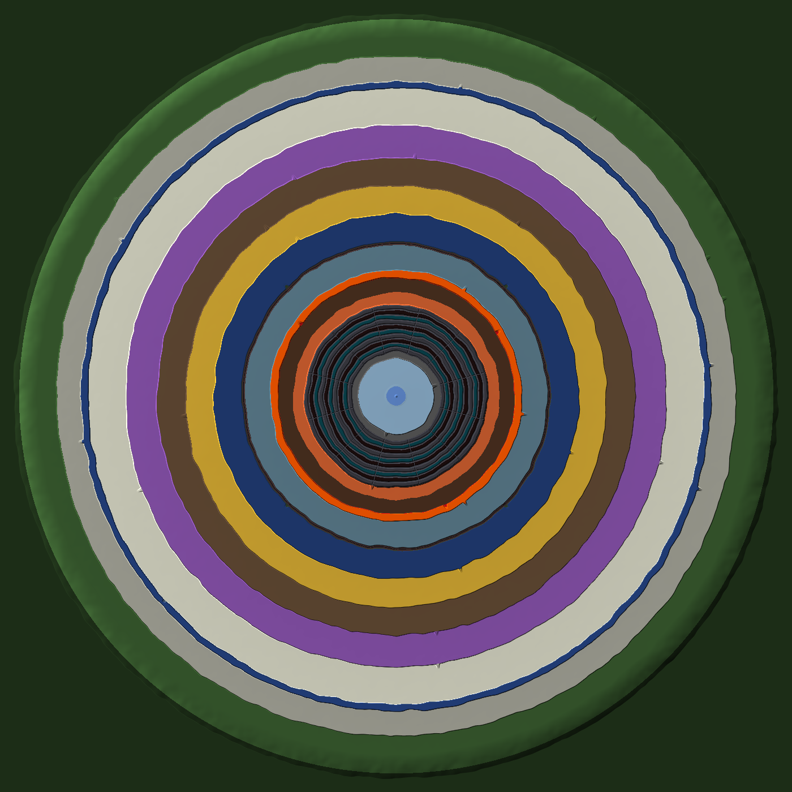
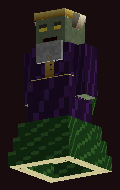
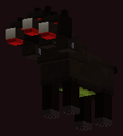
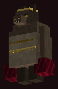
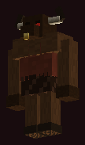
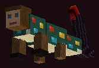

# Hellcraft

**Lasciate ogne speranza, voi ch'intrate.**

A Fabric mod for Minecraft **26.3** that reshapes the overworld into Dante's *Inferno*. The world is a funnel of nine circles terracing down to frozen Cocytus. The rules are Lifesteal SMP, where **blood is fuel** and **hell is full**.

**Hellcraft 3.0 is out:** a new, wider map with roads and a compass, every boss and monster on a real animated body, a rule to play with in every circle, Lucifer's two-part fight, the Nether rebuilt as the Forge of Dis, and Purgatory and Paradiso as worlds of their own (the plan was [the revamp](docs/REVAMP.md)). Since 3.0, **every player installs Hellcraft too** (the Hellcraft modpack, below), and 3.0 needs **a new world**. The old 1.21.1 version is frozen and no longer updated.



**New in 3.0:**
- **A new map.** Hell is 10,500 blocks across, with four Pilgrim Roads from the Gate to the Well of Giants, a way down every 30 degrees, a compass, the Map of Hell (M) and the Pilgrim's Journal (J).
- **Real bosses.** Every guardian, Lucifer, Vulcan, the Cyclopes and the Seraph have animated bodies, entrances and fights in the danger language (red: get out, white: block now, purple: jump or keep out), with a style panel and a Codex page each.
- **Circles to play with.** Lust's wind streams, Gluttony's mud, the sullen of the Styx, the tombs of Heresy, the thicket of the Wood of the Suicides, Malebolge's tricks, the cold of Cocytus and new monsters in every circle.
- **Lucifer.** The Fallen Seraph's duel, then the Three-Faced Emperor in the ice, and the climb out to Purgatory.
- **The Forge of Dis and Paradiso.** The Nether rebuilt round Vulcan's Great Forge, Purgatory's island in its own sea, and nine spheres of Paradiso with trials, angels and the Celestial Rose.

**New in 2.0 (26.3):**
- **The Seven P's.** Heart prestige: ascend at a Blood Altar for more hearts and a virtue each time.
- **The Blood Heart HUD.** Bleeding hearts in the health bar, rimmed bronze to white by your rank.
- **The Hall of the Damned.** A monument at spawn naming the Inferno's best and most damned.
- **Dante's Journey.** An advancement tab from the Dark Wood to the Empyrean.

**The title screen (3.1).** Hellcraft has its own: the HELLCRAFT logo burning over a painted view of Hell from the Walls of Dis (Lucifer in the pit with his wings spread, the river of blood, the circles rising behind), embers drifting up, *Lasciate ogne speranza* under the logo and a line of Dante for the splash. Minecraft's buttons are all where they were.

## Install it

Grab **Hellcraft 3.0.0** (the latest release) from the repo's [Releases page](https://github.com/the-small-things/hellcraft/releases). The next version is there too as a **beta** ("Hellcraft 3.1.0 beta"): newer, still being tested. A server and its players need the same version.

- **Modrinth App or Prism Launcher (easiest):** download `Hellcraft-<version>-mc26.3.mrpack` and import it as a modpack. That installs the right Minecraft, Fabric Loader and Fabric API for you. Use this to play single player **and** to join a Hellcraft server.
- **Official Minecraft Launcher:** download `hellcraft-<version>-mc26.3-mods.zip` and follow the `INSTALL.txt` inside. In short:
  1. Install Fabric Loader for Minecraft 26.3 with the [Fabric installer](https://fabricmc.net/use/installer/).
  2. Put both jars in `.minecraft/mods`.
  3. Play the `fabric-loader-26.3` profile.

**Joining a server:** your Hellcraft must be the same version as the server's. If it isn't, or you don't have it, the server tells you which version to install.

**Single player:** go to **Singleplayer → Create New World → World tab** and click **World Type** until it says **Inferno**. On the **Game** tab, turn on **Allow Commands** if you want the test commands below.

### Testing solo

| Command | What it does |
|---|---|
| `/hellcraft goto <zone>` | Teleport to any zone (tab-completes). For example `limbo`, `greed`, `walls_of_dis`, `malebolge_pitch`, `judecca`. |
| `/hellcraft gate` | Back to the Gate of Hell |
| `/hellcraft giveheart @s 5`, `/hellcraft givefragment @s 8` | Blood to test with (right-click to use) |
| `/hellcraft sethearts @s 1`, then die | Test elimination: you become a ghost and your revenant rises |
| `/hellcraft revive <yourname>` | Come back from being a ghost |

The Gate of Hell has an altar next to it for trying the rites. To test PvP lifesteal, open the world to LAN and bring a friend.

## Hosting a server (Docker)

1. Download `hellcraft-<version>-mc26.3.jar` from the [Releases page](https://github.com/the-small-things/hellcraft/releases), or build it yourself with `cd versions/26.3 && ./gradlew build` (the jar ends up in `versions/26.3/build/libs/`).
2. Put the jar in `docker/mods/`.
3. From the `docker/` folder, run:

   ```sh
   docker compose up -d
   ```

The compose file uses [`itzg/minecraft-server:java25`](https://github.com/itzg/docker-minecraft-server) with `TYPE=FABRIC` and `VERSION=26.3`. It downloads Fabric API automatically and creates the world with `LEVEL_TYPE=hellcraft:inferno`. Only the game port (25565) needs to be open.

**Every player needs the same Hellcraft version as the server** (the modpack above). Update the server and tell your players to update when you install a new version.

> The Inferno only generates in a **new world**. If you already have a world, stop the server and delete (or move) `docker/data/world` first. Lifesteal still works on an old world, but the land won't change.

Already running itzg? Add these to your existing container:
- env `TYPE=FABRIC`, `VERSION=26.3` (on the `java25` image), `MODRINTH_PROJECTS=fabric-api` and `LEVEL_TYPE=hellcraft:inferno`
- the jar, mounted into `/mods`

You need `LEVEL_TYPE=hellcraft:inferno` (`level-type=hellcraft:inferno` in `server.properties`). Without it the world generates as a normal overworld, and only the lifesteal rules apply.

## The shape of Hell

The world is a disc 10,500 blocks across, with the world border at radius 5,250 (3.0: a fresh world is needed; widened by half again after the 3.0 playtest found the circles too narrow). You spawn at the rim, in the Dark Wood, just outside the **Gate of Hell**: a black wall that rings the whole Vestibule and Acheron. It is crowned with towers of soul fire and pierced by 12 gates, each bearing Dante's inscription. Every gate opens onto a slope down into the Vestibule. Walking toward 0, 0 always leads down. Each circle sits on a terrace below the last, separated by cliffs.

**You can't get lost (3.0).** Four **Pilgrim Roads** (east, south, west and north) run from the Gate of Hell all the way to the Well of Giants. Each is paved in its circle's own stone and lit by lantern posts, worn like an old ruin (a half step of slab wherever the ground steps, and here and there a sunken stone), causeways over the rivers and a gate through the Walls of Dis. Off the road, every cliff has **a way down every 30 degrees**, like the hours on a clock (12 in all); only the Walls of Dis must be passed through their four gates, on the roads. The Wood of the Suicides and Cocytus have no cliff at all: the ground just slopes down. See [Finding your way](#finding-your-way-30) for the compass, the Map of Hell and the Journal.

| Ring | Circle | Land | Its torment |
|---|---|---|---|
| Dark Wood | – | Dark oak forest rising into mountains at the border. Animals, wolves, and (on 26.3) only a few monsters, so new players can find their feet. The Gate of Hell's wall runs along its inner edge. | – |
| Vestibule & Acheron | – | Grey gravel plain. The river Acheron. Bees stand in for the stinging wasps. | – |
| **Limbo** | I | The Grey Meadow (3.0): pale grass, calcite and birch in a mist, and (3.1) no colour at all: the world drains to grey as you walk in, and colour comes back only on the Noble Castle's green. The only villages in Hell, trail ruins, and the **Noble Castle** on the east road ([below](#the-noble-castle-30)). No fighting other players. | none: Limbo is only longing |
| **Lust** | II | The Storm Canyons: jagged tuff and deepslate spires with amethyst and crying obsidian. Breezes. Overhead, the souls whirl in vast flocks like starlings (3.0). | The wind is a road: white streams carry you down the circle |
| **Gluttony** | III | The Mire: mud, filthy pools and endless rain. Rotting giant trees (some fallen), bloated fungus, and sunken feast tables with a barrel of leftovers at the head (3.0). Hoglins and slimes. | The mud swallows whoever stands still |
| **Greed** | IV | The Counting House: blackstone, gilded blackstone and raw gold, heaped into hills of coin. Vaults with their round doors ajar (chests of gold, emeralds and diamonds) and giant scales tipped toward the gold; now and then a great coin as tall as a house comes rolling across, down a red line (get off it) (3.0). Piglins, buried bastions. | Gold draws the hoarders |
| **Wrath** | V | The Fen of Styx: a grey-green marsh in a light fog, walled with reeds, crossed by plank roads; the city of Dis glows red through the fog toward the centre. A watchtower with twin beacons stands on the shore beside each road (3.0). Drowned, and vindicators with Strength. | The sullen lurk under the water |
| Walls of Dis | – | A ring wall of blackstone brick with burning towers and 4 gates. | – |
| **Heresy** | VI | Soul sand and basalt, with fields of burning open tombs. Blazes, wither skeletons. | Pulses of Darkness |
| **Violence** | VII | Phlegethon, a river of lava with crimson banks, where skeleton "centaurs" ride skeleton horses. The Wood of the Suicides (a thicket of gnarled trees, black thorns, webs). The Burning Sands. | Breaking the trees hurts you. Fire rains on the sands. |
| **Fraud** | VIII | Malebolge: 10 concentric ditches crossed by 12 stone bridges. The ditch floors are pitch (magma and lava deltas) or blight (sculk). Ancient cities lie below. | 25% of monsters are invisible (26.3: 20%, never creepers, and they give themselves away with a swirl of particles) |
| Well of Giants | – | Nimrod and Ephialtes stand chained. Antaeus, unchained, stands in the ice below and carries souls down (3.0). | – |
| **Treachery** | IX | Cocytus, a frozen lake of packed and blue ice, with braziers scattered across it. At the very centre is Lucifer's pit, and in it the Emperor, asleep. | The cold builds while you're away from fire, faster toward the centre (3.0). Light the braziers: they stay lit for everyone. Leather armor protects, as in vanilla. |

At the bottom of the world waits **Lucifer** (see [below](#lucifer)).

**Supplies (26.3).** The Dark Wood is where pilgrims get ready: villages (plains and taiga, with farms, fletchers and librarians) and wandering traders are found there as well as in Limbo. Hell's dusk never ends, so villagers keep a clock of their own: a 10-minute day of work (they take jobs at job-site blocks as usual), a meeting at the bell, then about 3 minutes of idle time, which is when they breed (as in vanilla, they need free beds and enough food: bread, carrots, potatoes or beetroot). Their trades restock every 10 minutes. Oak and dark oak leaves drop apples six times as often as in vanilla. Sugar cane grows by the water in the Dark Wood, the Acheron, Limbo, Gluttony and the Styx, and the Acheron's banks have sand. Loot worth the detour:
- **Virgil's Rests** ([below](#virgils-rests-263)): a supply chest beside each road a third of the way into every circle, and four more between the roads
- **Ruined Blood Altars** (twice as common as before): arrows, books, a Vigil Candle, sometimes an enchanted book
- **Heretics' tombs**: one in four hides a chest of forbidden books (enchanted books of level 15-30, paper, lapis, bottles o' enchanting)
- **Circle guardians**: 2 Blood Hearts, fragments, a Soul Anchor, 2 level-30 enchanted books and more
- **Sunken feast tables** (Gluttony): a barrel of food, gold nuggets, sometimes a golden apple or a book
- **Vaults** (Greed): gold, emeralds, diamonds, sometimes an enchanted golden apple (beware: gold draws the hoarders)
- **Watchtowers** (the Fen): a cache at the foot of the ladder: a boat, water breathing, sometimes a trident

Some other rules of Hell:
- It is always dusk, so monsters never burn.
- Beds explode and respawn anchors don't work.
- Monsters get tougher the deeper you go.
- The monster mob cap is 1.75× vanilla on 1.21.1 (vanilla on 26.3, where the circles are gentler; see [the torments](#the-torments-of-the-circles)).
- A card names each circle as you enter it, and says what it does to you and the gear to bring.
- Each circle has its own ambience (26.3): the wasps of the Vestibule, Charon's oar on the Acheron, the sighs of Limbo, the hurricane of Lust, rain in Gluttony, chinking gold in Greed, the bubbling Styx, crackling tombs, boiling blood, far-off screams in Malebolge and creaking ice in Cocytus. Turn it off with `circleAmbience`.

### The Noble Castle (3.0)

Halfway across Limbo the east road runs through the **Noble Castle**: "seven times encircled by high walls, defended round about by a fair rivulet" (Inferno IV). Its seven tiers of pale walls each have a gate on the road (and on the other three axes), and inside lies the only green meadow in Hell, with a pavilion of light on a mound at its heart. The great souls who lived before Christ live on there as **shades**: pale, see-through, harmless. **Right-click one** to talk: it says something worth knowing (in its own voice, but plainly), gives you a page for your Codex the first time, and trades for emeralds. Their wares restock every 10 minutes.

| Shade | Codex page | Trades (emeralds) |
|---|---|---|
| Homer | Cerberus | Sharpness II book, iron sword |
| Horace | Plutus | bread, cooked beef, golden carrots |
| Ovid | the hoarders | Slow Falling (for Lust's wind), Water Breathing (for the Styx) |
| Lucan | Phlegyas | shield, bow, arrows |
| Aristotle | Minos | ender chest (to stash gold from the hoarders), spyglass |
| Euclid | the lovers | ladders, torches, lanterns |
| Hippocrates | the gluttons | Healing, Regeneration, a golden apple |
| Hector | the wrathful | iron armour |
| Saladin (alone, apart, by the outer wall) | – | saddle, iron horse armour, leads |

## The dialogue box (3.0)

What the souls of Hell say to you no longer fills the chat. The guardians, Lucifer, the shades of the Noble Castle, Virgil's tips, Dante's line as you enter each circle, the voice in the Spine and Hellcraft's own notices (a Rest remembered, a Codex page, the ferry) appear one at a time in a **dialogue box above the hotbar**: the speaker's name in their colour, then the words typed out. A line stays long enough to read, less when more are waiting; a shout shakes the box. Lines wait while a cutscene plays. Chat keeps what the whole server should hear (a guardian slain, Cain's Mark, a tunnel opening in the pit).

## Finding your way (3.0)

- **The compass**, at the top of the screen while you're in Hell: north, east, south and west, a **red arrow** to the nearest way down into the next circle (a ramp, a Gate of Hell, a gate in the Walls of Dis, a Spine or Lucifer's pit) and a **gold diamond** for the nearest Virgil's Rest (grey until you've found it), with how far each is. Under it, the name of where you stand and a thin **depth bar** that fills as you near the pit. It steps aside while boss bars show.
- **Circle cards.** Entering a circle shows its name, typed out big ("CIRCLE II: LUST"), one plain line on what it does to you and how to deal with it, and the gear worth having there. `circleTitles: false` turns them off.
- **The Map of Hell (M):** the whole funnel from above, drawn from the same shapes as the terrain: the roads, rivers and walls, every way down, the Rests (gold once found), the guardians' lairs (grey once beaten) and you. Scroll to zoom, drag to move, and point at anything to see what it is.
- **The Pilgrim's Journal (J):** where you are, your goal, the next step (which way and how far), the nearest Rest, the guardians you've beaten, and every page of the Pilgrim's Guide with this server's numbers.

The keys can be changed under Options → Controls → Hellcraft.

## Blood is fuel

New players start with 5 bread and 2 **Vigil Candles** (26.3), and chat points them to the **Pilgrim's Journal** (J): its pages are Virgil's guide to hearts, blood, reviving, the circles, the weapons, the spines and Lucifer, with numbers that follow your config. `/guide` opens it too. (3.0: the written guide book is gone.)

**Hearts show next to every name in the player list** (26.3). Once someone has cast Lucifer down, a **Hall of the Damned** sidebar lists every slayer and how many times they won. Toggle these with `tabListHearts` and `sidebarHall`.

**The Hall of the Damned monument** (26.3) stands just north of the spawn.
- Five blackstone pillars: **Most Hearts**, **P's Burned**, **Lucifer Slain**, **Guardians Slain** and **Most Damned** (most deaths).
- Each pillar is signed with its top three and crowned with the leader's head.
- It updates every minute. `/hellcraft hall` shows the same standings in chat.
- Turn it off with `hallMonument`.

**Dante's Journey** (26.3) is Hellcraft's own advancement tab. It follows the poem:
- the Dark Wood, then each of the nine circles to Judecca;
- the five guardians, then Lucifer;
- the climb out to Purgatory, and the Seven P's;
- the Forge of Dis and Vulcan in the Nether;
- Paradiso's nine spheres, the Seraph, and Beatrice's Rose in the Empyrean.

- **Hearts.** You start with 10 hearts and can hold up to 20.
  - Killing a player steals one of their hearts.
  - **26.3: only players take hearts.** Dying to monsters, lava, falls or the circles costs your items and XP like vanilla, never a heart. Set `pveDeathsCostHearts` to bring back the old rule.
  - 1.21.1 (or with `pveDeathsCostHearts`): dying to anything else costs a heart too, and it drops as a **Blood Heart** where you fell, so you can go back for it.
- **Blood Heart**. Right-click to gain a heart. `/withdraw [n]` turns your own hearts into Blood Hearts you can trade.
- **Blood Fragment**. Hostile mobs killed by players drop fragments. The chance rises from 5% in the outer circles to about 19% in Cocytus (26.3; 2% to 12% on 1.21.1). Right-click with 8 in one stack (`fragmentsPerHeart`) to clot them into a Blood Heart.
- **A way back (26.3).** Two one-time respawn items:
  - **Vigil Candle** (craft: torch + bone + string). Right-click to light it where you stand. Your next death wakes you beside it, then it's gone. One lit candle at a time.
  - **Soul Anchor** (every circle guardian drops one; rare in deep loot). Carry it. If you die, you rise again at the last solid ground near where you fell, with a few seconds of protection, and it breaks. Your dropped items are right there.
  - Neither works in Lucifer's pit. On respawn the anchor goes first, then the candle, then a bound altar.
- **Boss rewards.** The Wither gives 1 Blood Heart, the Warden gives 1 and the Ender Dragon gives 2. Lucifer has his own rewards (below).

### The Seven P's (26.3)

At the gate of Purgatory an angel carves seven P's on every brow, one for each deadly sin, and each terrace of the mountain burns one away. In Hellcraft, **a soul whose veins are full can ascend**. Open a Blood Altar's menu and click **Ascend** (the feather).
- Your hearts fall back to 10 (`prestigeResetHearts`).
- One P is burned away.
- You can hold **2 more hearts for good** (`prestigeHeartBonus`).
- You keep that terrace's **virtue**.

Seven ascents take the cap from 20 to 34 hearts, not counting Lucifer's Bane.

| P | Terrace | Virtue |
|---|---|---|
| I | Pride | **Humility**: 30% less fall damage |
| II | Envy | **Kindness**: monsters drop Blood Fragments 10% more often |
| III | Wrath | **Meekness**: +25% knockback resistance |
| IV | Sloth | **Zeal**: +5% walking speed |
| V | Greed | **Liberality**: +1 luck (better loot) |
| VI | Gluttony | **Temperance**: hunger gnaws more slowly |
| VII | Lust | **Purity**: the circles' torments no longer touch you |

**How your rank shows:**
- A coloured cross (`✝I` to `✝VII`, bronze through gold to white) appears before your name in the player list and above your head.
- The rims of your hearts take the same colour.
- Every ascent is announced to the server.

`/hellcraft prestige <player> [set <n>]` shows or sets a rank. Turn the whole system off with `prestige`.

### The Blood Heart HUD (26.3)

The resource pack replaces the health bar with Hellcraft's own hearts: dark, glistening blood with a drop running off the point. In hardcore they turn to ember-lit black blood. Each player also gets a tiny second pack that re-rims their hearts in the colour of their rank. Turn it off with `heartHud`.

### Blood altars

An altar is a **respawn anchor on a 3×3 of crying obsidian**. There is one at the Gate of Hell, and ruined altars with loot chests are scattered through Hell. You can build your own, too.

**26.3:** right-click an altar with an empty hand to open its menu. It shows every ghost's head (click one to revive them) plus the Ward and Bind rites. The Gate's altar has a sign saying so.

| Rite | How | Cost | Effect |
|---|---|---|---|
| **Revive** | Menu: click the ghost's head. Or stand by the altar and type `/revive <name>`. Or use a Name Tag renamed to their name. | 4 Blood Hearts | The ghost rises on top of the altar with 3 hearts |
| **Ward** | Menu, or use a Blood Heart on the altar | 1 Blood Heart | 30 minutes of immunity to every circle's torment, plus Regeneration and Absorption |
| **Bind** | Menu, or sneak and use a Blood Heart on the altar | Free on 26.3 (`bindCostHearts`); 1 Blood Heart on 1.21.1 | You respawn at this altar (beds explode, so this and the respawn items are how you move your spawn) |

(On 1.21.1 there is no menu: use the Name Tag and Blood Heart shortcuts.)

### Hell weapons (26.3)

Four weapons and tools of their own (3.0: real items, in the creative tab and `/give hellcraft:bloodletter`), forged at a crafting table from a vanilla tool with Blood Fragments (and, for the stronger ones, Blood Hearts). They're in everyone's recipe book, and swinging them costs nothing. Ones made before 3.0 (vanilla tools with the blood marks) keep working:
- **Passive**: every fully charged hit does something extra (below).
- **Blood charge**: charged hits on monsters (and players) add 5%, kills add 20%. The action bar shows the meter, and the weapon glows when it's full. **Right-click at 100%** to unleash its **Blood Art**. You lose the charge when you die.
- **Blood Oath**: sneak and right-click (in the air or at a block) to pay **3 hearts of health** (not max hearts) for a full charge and **30 seconds of full power**. It needs more than 4 hearts of health, and your blood takes 3 minutes to recover before the next oath.

| Weapon | Recipe | Passive (charged hits) | Blood Art (right-click at full charge) | Blood Oath |
|---|---|---|---|---|
| **Bloodletter** (sword) | iron sword + 4 Blood Fragments | 3 s of bleeding (Wither), heals you ½❤ | **Exsanguinate**: lunge 6 blocks, cutting everything in your path for 8 with deep bleeding, healing 1❤ per foe | +10 damage, deep bleeding, each hit heals you 1❤ |
| **Reaper of Minos** (scythe) | diamond hoe + **2 Blood Hearts** + 4 Blood Fragments | cleaves everything within 3 blocks of the target for 4 | **Harvest**: everything within 5 blocks takes 12, slowed and dragged toward you | every hit is a Harvest around the target |
| **Tithe Axe** | diamond axe + **1 Blood Heart** + 6 Blood Fragments | kills drop Blood Fragments twice as often | **Blood Frenzy**: Strength II, Speed II and Haste II for 15 s | Strength III, Speed II, Resistance, hits heal 1❤ |
| **Blood Pickaxe** | diamond pickaxe + **1 Blood Heart** + 3 Blood Fragments | breaking an ore breaks the rest of its vein (12 blocks; sneak to mine just one), and ores you mine fill its blood (2% each) | **Excavate**: for 20 s every block you mine takes the 3×3 around it, with Haste II | Excavate, Haste III and Night Vision |

The Reaper's cleave never touches villagers, pets, the mount you're riding, or players you couldn't hit anyway (PvP off, same team).

Excavate's 3×3 only takes blocks the pickaxe can mine and that are no harder than the one you broke, so it never cuts through obsidian, bedrock or chests. Vein mining and Excavate use the pickaxe like normal mining: Fortune, Silk Touch and durability all apply. Every hell weapon, the pickaxe included, can be made infernal at the Hellforge.

`/hellcraft giveweapon <player> <bloodletter|reaper_of_minos|tithe_axe|blood_pickaxe>` hands one out for testing.

### Blood armour (26.3)

Four pieces of armour of their own (3.0: real items), forged at a crafting table: each is the diamond piece plus 4 Blood Fragments. They're in everyone's recipe book. At a Hellforge they become **infernal**: netherite's protection, fire-proof.

They protect like diamond, look like crimson plate with bone rivets and burning eye slits (from the resource pack), and work as a set:
- **2 or more pieces:** your melee hits heal you 5% of the damage they deal.
- **All 4:** 10%, plus a **Blood Rush** (Regeneration II for 5 s) when you drop below 3 hearts of health, once a minute. A Blood Oath also gives you Resistance while it lasts.

`/hellcraft givearmour <player>` hands out a set for testing.

### The circles' enchantments (3.0)

Five enchantments that no enchanting table, librarian or ordinary chest gives: each is found as a book in one circle only. Put them on at an anvil.

| Enchantment | On | What it does | Found |
|---|---|---|---|
| **Windstep** I–III | boots | +8% walking speed per level | Lust: the lovers sometimes drop it |
| **Quickening** I–II | swords, axes (and the Reaper) | +10% attack speed per level | Greed: the vaults of the Counting House |
| **Sidestep** I–III | leggings | the **Dash** key (Left Alt; Controls, Hellcraft) throws you a few blocks the way you're moving (back, if you stand still), and a boss's blow passes through you mid-dash. Once every 3 / 2.25 / 1.5 s | Wrath: the caches at the foot of the Fen's watchtowers |
| **Steadfast** I–IV | chestplate | bosses (the guardians, Lucifer and what they bring) hurt you 7% less per level | Heresy: the tombs |
| **Judgement** I–V | swords, axes (and the Reaper) | your blows hurt bosses 1.5 more per level | Violence: the centaurs sometimes drop it |

## The circle guardians (26.3)

Eight of Dante's monsters wait in lairs ringed with soul-fire braziers, each well inside its own circle and spread round the funnel (3.0: they no longer stand in a line by the east road; the Map of Hell (M) shows where), each with a sign by its ring. **Each has four lairs** in its circle, a quarter of the way round Hell from each other (one in each quarter, so one is never far off: Phlegyas has a landing by every watchtower, the Furies wait inside every gate of Dis). Fight it in whichever you like; it's awake in one lair at a time, and beaten, it sleeps in all of them. The table gives the first lair. None of them blocks the way down. Each lair's floor is level ground (3.0), so its fight can be read. Walk into a lair and its guardian wakes (Phlegyas also comes when you light the east watchtower's beacons). It gets a title card, a boss bar and its own model, and each extra player in the lair gives it +50% health. Every attack is telegraphed, and the action bar tells you how to dodge it:

**Lifts and lore (Phase 8).** Beat a guardian and its lair keeps a lift for you (REVAMP Q2): a column of soul fire in the middle of the lair. Stand in it for 3 seconds and it takes you down to the next circle: Minos's to Gluttony, Cerberus's to Greed, Plutus's to the Styx (onto the nearest road's causeway), Farinata's to the Wood of the Suicides, the Minotaur's to the Burning Sands. Only those who have beaten that guardian can use it; the roads and ramps stay open for everyone. Phlegyas's ferry, Geryon's flight and Antaeus's hand are the other rides. And every guardian says something about Lucifer as it falls: the Journal's Codex has a page on **the Emperor** that fills in, one piece per guardian you beat.

| Guardian | Lair | Attacks |
|---|---|---|
| **Minos**, Judge of the Damned (3.0: a real, animated body) | Lust, to the south-east | *The Claw* (white): a claw from on high; block it with a shield as it lands and he staggers, armour gone, for two seconds. *Tail of Judgement* (purple): his tail sweeps the ground in a full circle (jump it as it passes). *Sentence* (red): a red circle follows one player, stops, then the hurricane tears up the ground there (keep moving). *Coil* (a red line): his tail lunges along the line and squeezes whoever is still in it, until the others deal him 15 damage. At half health he rears up in fury: every player is sentenced at once and he attacks faster. |
| **Cerberus**, the Great Worm (3.0: a real, animated body with three heads) | Gluttony, to the south-west | He stalks you round the lair (and the mire's mud takes whoever stands still). *Bite* (white): one head flashes white and snaps; block it as it lands and he reels for two seconds. *Three Maws* (a red cone): all three bite in front of him one after another (get behind him). *Filth* (red circles): puddles that slow and sicken. *Howl* (a purple ring): can't be blocked; be out of it or be stunned. At half health he rears up and slams the ground (a red ring), and from then on charges along red lines. |
| **Plutus**, the Great Enemy (3.0: a real, animated body, a golden wolf-headed banker) | Greed, to the north-west | He waddles after you. *The Fist* (white): block it as it lands and he reels. *Weight of Gold* (red circles): gold falls there, harder on whoever carries more gold (leave it behind). *Lunge* (a red line): he hurls himself along it. *Pape Satàn* (a purple ring): a shriek that can't be blocked; it scatters and sickens. At half health the Mint opens: great coins as tall as a house roll across the lair along red lines. |
| **Phlegyas**, the Ferryman of the Styx (3.0: a real, animated body) | the Fen, a plank landing by the east watchtower | Walk into the ring of braziers round his landing, or light both beacons on top of the east watchtower (flint and steel), and he rises from the pool at its heart. Fight from the planks. *The Oar* (a white line): block it as it lands and he reels. *The Sweep* (a purple ring): his oar skims round the deck, jump it. *The Wave* (a red ring over the deck's outer part): get in close or be thrown into the Styx. *The Grab* (a red circle that follows you): he throws whoever is in it out into the marsh, where the sullen lurk. At half health the sullen's hands burst up through the deck in red circles. Beaten, he leaves his ferry at the landing. |
| **The Furies**, the Erinyes of Dis (3.0: three real, animated bodies, one life) | just inside the south gate of Dis | They wheel over the lair and come down one at a time; a blow to any of the three counts. *The Talons* (a white circle that follows you): block as she drops and she tumbles to the ground. *The Shriek* (a purple circle under her): get out from under. *The Lash* (a red line): her serpent hair cracks along it. *Tears of Blood* (red circles). At half their life they call **Medusa**, who rises over the battlements: while her eyes glow, don't look at her. Whoever does turns to stone (the screen greys as it starts; look away and it clears). |
| **Farinata**, the Proud Heretic (3.0: a real, animated body) | Heresy, to the west | He stands in his burning tomb and never leaves it; eight tombs ring it. *Disdain* (a white line): fire runs along the ground at you; block it and he sinks into his tomb, open to blows. *The Pyres* (red circles on the tombs): they blast in patterns (every other one, round the ring, all but one): stand by a cold one. *Exile* (a purple ring round him): keep out. At half health every command fires twice. |
| **The Minotaur**, Infamy of Crete (3.0: a real, animated body) | a clearing in the Wood of Suicides, to the north | He hunts you round the lair. *The Horns* (a white wedge): block the thrust and he drops to one knee. *The Charge* (a red line): step aside; if he runs into rock he stuns himself. *The Stomp* (a red circle round him). *The Frenzy* (a purple ring): he whirls with his fists out; jump it or keep out. At half health he charges twice in a row. |
| **Geryon**, Image of Fraud (3.0: a real, animated body) | the brink of the great cliff, to the north-east | He swims in the air. *The Sting* (a white circle that follows you): block it and he sags to the ground. *The False Face* (purple lines): he and two copies dive along them; one blow pops a copy. *The Coils* (a red ring round the lair's edge): get to the middle. *The Dive* (a red line). At half health venom drips where you stand. Beaten, he doesn't die: he stays at the brink and carries souls down (below). |

**The ferry (3.0).** Light both beacons on any watchtower of the Fen and Phlegyas's ferry comes gliding out of the fog to the water by the tower. Right-click it to board; a few seconds later it carries everyone aboard across the Styx, skimming over the reeds and boardwalks, and sets them down on the road inside the gate of Dis (sneak to get off before it leaves). Nobody aboard can be hurt, by the sullen or anything else. At the east tower the beacons call Phlegyas himself while he is there to fight; once he is beaten his ferry waits at his landing. The roads cross the Styx on causeways too: the ferry is a shortcut, never the only way.

**Geryon's flight (3.0).** Once Geryon is beaten he waits at the brink of the great cliff. Right-click him to climb on (two can ride); a few seconds later he glides out over the abyss and wheels slowly down, in wide loops over the first ditches, to the fourth ridge of Malebolge, as he carried Dante. He waits there a while for anyone going back up (right-click him again), then flies home. Nobody riding him can be hurt; don't sneak in the air, or you let go (you fall slowly, at least). The cliff's ramps are still there: he is a shortcut, never the only way.

**Lucifer's wings (3.0).** Every few minutes, all over Hell at once, the ground shudders: the view shakes, a great slow flap is heard far below and frost creeps in at the screen's edges, stronger the deeper you are (a sudden chill in Cocytus). That is Lucifer's wings beating at the bottom of Hell. From the Well of Giants you see him far off across the ice, something like a giant windmill turning in the fog: his wings. He grows clearer as you cross Cocytus, and he sleeps in the pit, chest-deep in the ice, until someone comes down to him.

**Antaeus (3.0).** The unchained giant stands in the ice of Cocytus at the foot of the Well of Giants, his hand resting on the rim of a cleft worn in the cliff. Wait on the crying obsidian at the brink by his hand: he lifts you, bends, and sets you down on the ice. To go back up, wait on the crying obsidian beside his hand down on the ice. Nobody in his hand can be hurt.

**Time to react (3.0).** The guardians fight at 60% of their old pace (`bossTempo`): every wind-up, warning on the ground, white parry window and pause between blows lasts longer, and their animations slow to match, so there is time to see a blow coming and get out of the way or raise your shield. The flyers come down to be hit: Geryon sinks to just above the ground after each attack, and a Fury lands where her talons strike and stays down a moment. Lucifer, the last fight, runs faster (`luciferTempo`, 0.85) and hits for 90% (`luciferDamage`). **Late blocks count (playtest):** against a boss or one of Hell's monsters a shield blocks the moment it's raised (vanilla only counts it a quarter of a second later), so a block timed to the white flash works; it must still face the blow.

A slain guardian sleeps for 30 minutes (in all four of its lairs). If everyone leaves its lair, it goes back to sleep at full health.

**The danger language (3.0).** The same colours mean the same thing on every boss, and Virgil explains each the first time you see it:
- **Red** on the ground: get out of it before it fills. A shield won't help.
- **White**: the boss flashes white and the ground where the blow will land shows white. Raise your shield now: blocking that blow in time staggers the boss (a parry).
- **Purple**: can't be blocked. Jump it, or get out of the way.

Marks are drawn block by block on the ground, fill from the middle out, and the blow lands as they fill. Each colour has its own sound: a low horn for red, a bell for white, a chime for purple.

**Blows you can't miss (3.1).** When a blow lands, its whole mark erupts in its colour: red bursts into fire, smoke and flying earth, white cracks with light and sparks, purple tears open in violet. A circle sends a shockwave out from its edge and a column up from its heart, a line blasts along its length, and if you're standing close the view shakes. The bosses' other effects (splashes, gold, flames, light) are twice as dense and show from across the arena, whatever your particle setting. Ops can try it anywhere with `/hellcraft danger show` (a red circle, a white ring and a purple line in front of you).

**Minos's entrance (3.0).** When Minos wakes, everyone near his lair sees a short cutscene: he rises out of his coils and roars, his name card comes up, and Virgil says how to read the fight. You can't be hurt while it plays, and you can skip it (the jump key) once you've seen it. The fight starts when it ends.

**The Codex (3.0).** Meeting a boss opens its entry in the Journal (J): who it is, how to fight it, and Dante's words about it.

**Animated models (Lucifer too).** Since 3.0 every boss has a real, jointed body animated with Minecraft's own keyframes: an entrance, an idle, a wind-up before every blow (timed to its warning on the ground), a flinch when hit and a death of its own.

**No cheesing (these rules also apply to Lucifer where it says so):**
- **Hearts help, but don't make you a tank.** Boss hits grow with your heart capacity (3.0: half as fast as before), so 40 hearts takes 2.5 times the damage of 10: more hearts still last longer, but dodging the telegraphed attacks is the way to win. (Lucifer too.)
- **Arrows do 40% damage** to a guardian, and to the Fallen Seraph. Geryon flies, so arrows do full damage to him.
- **Shoot from afar and you get pulled in.** Hit a guardian with an arrow from more than 8 blocks away and, a second after a warning, it drags you toward it (at most once every 8 seconds).
- **You can only hurt a guardian from inside its lair.** Damage from outside the brazier ring does nothing.
- **No building in a lair while its guardian is awake,** and anyone standing more than 6 blocks above the guardian for 3 seconds is dragged down beside it.

**Spoils are personal, and they pay for style, not play time.** In every boss fight (the guardians, Vulcan, the Seraph and Lucifer) each player has a **STYLE** panel on the right of the screen (since Phase 8): the rank as a big letter, a meter to the next rank, and a feed of what just scored or cost ("+ PARRY", "- HIT"). Ranked like ULTRAKILL's:

| Rank | Name | Style needed | Blood Fragments for the win |
|---|---|---|---|
| **D** | Damned | 0 | 1 |
| **C** | Cruel | 30 | 2 |
| **B** | Brutal | 70 | 3 |
| **A** | Anarchic | 120 | 4 |
| **S** | Savage | 180 | 6 |
| **SS** | Sinful | 250 | 8 |
| **SSS** | Satanic | 330 | 10 |

- **Hitting the boss fills the meter**, more for a full-strength blow than for spam-clicking.
- **Freshness:** a weapon used again and again goes stale (FRESH, USED, STALE, DULL) and scores less, while the others freshen up. Swap between sword, axe, mace, spear, trident and bow.
- **Extra style** for a critical hit, a mace smash, hitting while airborne, blocking a boss's blow with a shield, killing the boss's summons, and every 10 s close to the boss without getting hit.
- **It drains** whenever you hold back (faster the higher you are), and **getting hit takes a big bite**. Dying resets it, and your rank for that fight can't go above B.

When the boss dies, your **rank is the average of your style over the fight**. Chat tells you your rank, what it paid, and what to do better.

- **Every victory** pays Blood Fragments by rank, straight into your inventory. **S or better** adds a treasure roll (enchanted books and more).
- **Your first victory over a guardian:** 2 Blood Hearts, 3 extra fragments, a Soul Anchor and a treasure roll, at any rank.
- **Your first S and your first SSS against each boss:** a Blood Heart each, once.
- **Again after 3 hours:** 1 Blood Heart, but only for a victory ranked S or better (a lower rank doesn't use up the wait).
- **Lucifer:** his full reward comes back every 6 hours. A win in between pays twice the fragments, plus a treasure roll for S or better.

Config: `guardians`, `guardianRespawnMinutes`, `guardianHealthMultiplier`, `guardianHearts`, `guardianRepeatHearts`, `guardianSpoilsCooldownMinutes`. The rules above: `bossHeartScaling` (0.5; 1.0 = full scaling, 0 = off), `bossTempo` (0.6; 1.0 = full speed), `luciferDamage` (0.9), `luciferTempo` (0.85), `bossProjectileDamage` (0.4), `bossPullsArchers`, `bossNoBuilding`. Ops can use `/hellcraft guardian <name> summon|slay|stop|status|attack <attack>`.

| Minos | Cerberus | Plutus | The Minotaur | Geryon |
|---|---|---|---|---|
|  |  |  |  |  |

## Lucifer

*"Another soul crawls to the bottom of the world."*

### The Emperor's Spines (26.3)

*"Nothing will touch thee on this road. I want thee WHOLE when thou arrivest."*

The road to Lucifer is a quiet one. At each point of the compass on the **rim of the Well of Giants**, a colossal backbone leaves the cliff and runs toward the centre of Hell. They start 450 blocks out at y −13: east (450, 0), south (0, 450), west (−450, 0) and north (0, −450), where the four roads end. `/hellcraft spine [north|east|south|west]` takes an op there.
- For about 340 blocks it hangs over **Cocytus**, 25 blocks above the frozen lake, with ribs curling down into the dark and soul lanterns along the way. It broke when he fell (3.0): each spine sags off the straight line in its own long curves, and no two of its bones are alike (some ribs are snapped short or splintered, a few are gone). Its ends stay where they are.
- Over **Judecca** it becomes a long **staircase**, one step down every four blocks, all the way to the rim of Lucifer's pit.

**No enemies.** Nothing hostile can exist on or near a spine, or anywhere in Judecca. The freezing of the ninth circle spares you while you walk it. The only company is a heartbeat that quickens the deeper you go, ash drifting in the dark, and **Lucifer's voice from far below**, a new line at every stretch of the descent.

The first time you reach the Well of Giants or Cocytus, chat tells you where the nearest spine starts. Their bones can't be broken. Worlds made with just the east spine get the other three on their next start.

### The fight (3.0)

Lucifer's pit is a flat floor of ice about 70 blocks across at the very centre of Judecca, walled in by sheer ice. In the middle of it, chest-deep in the frozen lake, sleeps a mountain with three faces.

**The ready check.** Step down onto the pit's floor and everyone near hears it: the fight starts in 30 seconds, or 5 seconds once everyone nearby is down in the pit. Ten seconds before it seals you're told it's the point of no return, so anyone not ready can climb back up. If everyone leaves the pit, it's called off. Once it seals, nobody gets in or out until Lucifer or the last of you falls. Six **ice pillars** rise round the floor: you'll want them later.

**The pit can't be broken.** Its ice (the floor, the wall and the pillars) can't be mined except in creative, and whatever explosions blow out of the floor during the fight freezes back within half a second.

1. **The Fallen Seraph.** A cutscene: a shining angel with six white wings comes down between you and the sleeping mountain. Lucifer as he was before the Fall, gentle, kind, telling you to lower your blade. He is still the boss. He glides round you and fights like a duelist, in Hellcraft's danger language:
   - **White flash, white cone:** his blade. *Raise your shield as it lands:* he reels, open, for two seconds.
   - **Purple ring:** his wings sweep all the way round. It can't be blocked. *Jump as it reaches you, or be out of the ring.*
   - **Red circles:** stars fall there. *Step out.*
   - **Red line:** he lunges along it. *Step aside.*
   - **His guard (from the playtest).** His wings turn most of your blows aside: only 30% gets through. **Block his white slash** to break his guard, and for a few seconds your blows do 160%. Hit him three times quickly at his guard and he answers at once with the slash, so standing and trading blows doesn't work: block, then strike.
2. **The Morning Star.** At half health his kindness snaps ("ENOUGH!"). He glows, moves faster, often strikes twice, the stars keep falling round you while he fights, and Judas, Brutus and Cassius crawl out of the ice to fight for him.
3. **The Three-Faced Emperor.** Break the Seraph and he shatters like glass. Another cutscene: the mountain in the middle of the pit opens its eyes. It was him all along: Dante's Lucifer, frozen to the chest, three faces (red, pale yellow, black) and six bat wings. He can't move, but his reach is the whole pit, and **he can only be hurt where he opens up**:
   - **Red, under a hand:** the hand slams down. *Get out of the red.* Then it stays down on the ice, glowing: **hit the hand** while it lasts.
   - **White flash:** a face bites. *Block it* and the face stays down, glowing, longer, and takes three times the damage; dodge it and it's down for a moment at half that.
   - **Purple ring round the whole pit:** his wingbeat. It can't be blocked or jumped: **get behind an ice pillar** (anywhere his head can't see you) before it comes.
   - **Red, both hands:** both hands come down at once, either side of him; both stay down to be hit.
   - **Red circles in an arc:** a hand laid on the ice and dragged round as he turns in the ice. *Get off its path.* It lies still at the end: hit it.
   - **Red wedge:** his frozen breath, sweeping across the ice as he turns. *Get out of the wedge or behind an ice pillar.* The face hangs low after: hit it.
   - **Red circles, from half health:** he weeps, and his tears fall as ice. *Keep moving.*
   - **Small red circles round you, all fight long:** icicles shaken from his wings, whatever else he's doing.

   He picks his blows at random (never the same twice running), with little rest between them.

   Every attack is told on the ground first, and the first time you see each one a plain tip says what to do.

**Returning champions make him harder.** For every player in the fight who has beaten him before, he gets tougher for *everyone* in that round:
- +35% health on both forms
- +20% damage
- faster attacks
- more falling stars and tears
- an extra traitor

With two or more champions, the traitors rise from the start. He calls champions out by name, and their difficulty shows as ✦ on his health bar.

**The climb out.** When he freezes for good, everyone still standing in the pit climbs down his shaggy side with Virgil (a last cutscene, the world turning over as you pass his middle) and comes out on the shore of **Purgatory**. Anyone who missed it can still take the burrow (below).

**Rewards: pick ONE.** When he falls, every fighter still **alive in the pit** gets a chest-style menu (reopen it any time with `/lucifer reward`). There are no spoils for those who died before he did.
- **First victory:** pick one of
  - *Wings of the Morning Star* (Elytra)
  - *Morning Star*, a netherite sword with Sharpness V, Fire Aspect II, Looting III, Unbreaking III and Mending
  - 2 Totems of Undying
  - 2 Enchanted Golden Apples
  - 4 Blood Hearts
  - **Lucifer's Bane**
- **Later victories:** pick a Totem of Undying, an Enchanted Golden Apple, or 2 Blood Hearts.

### The climb out: Purgatory (26.3)

*"Thence we came forth to rebehold the stars."*

When Lucifer falls, the fighters climb straight out (above), and a **burrow** (an end gateway) opens in the ice at his back, for five minutes, for anyone who missed it. Step in and you climb out onto the shore of **Purgatory**: since Phase 7 its own small world, a mountain island in a starlit sea, in the hour before dawn:
- **Seven terraces** spiral up the mountain, one for each capital sin, with stairways cut into the cliffs. Each has a sign, and at each new terrace an angel's wing erases a P from your brow.
- The **Earthly Paradise** on the summit has flowers and trees and two streams:
  - **Lethe** (west) washes away every harmful effect, fire and frost.
  - **Eunoë** (east) gives +2 hearts (up to your cap) and a full heal, once for every victory over Lucifer.
- The **Gate of Return** in the middle of the garden takes you back to the Gate of Hell.
- **The Ascent**, a second gateway on the summit, lifts anyone who has cast Lucifer down into **Paradiso** (below).

`/hellcraft purgatory` takes an op to the shore.

**Lucifer's Bane** permanently raises your heart cap by 2 when you right-click it. It's an item, so it can be traded, and each one you consume adds another +2.

### Lucifer's look (26.3)

Since 3.0 Lucifer has two real, animated bodies: the **Fallen Seraph** (an angel twice your height, six white wings, a sword of light) and the **Three-Faced Emperor**, a giant 10 times that size frozen in the middle of the pit, whom you see from across Cocytus as a windmill turning in the fog. The client tests film every animation of both (`fallen_seraph_*` and `emperor_*`) and the whole fight (`lucifer_*`).

### Boss music

The fight has music: a different track for the duel, the enraged phase and the true form. Until Hellcraft ships its own tracks, everyone hears vanilla music discs ("Creator", "Pigstep" and "Precipice"; change them with the `fallbackMusic…` settings). Hellcraft's own tracks will ship inside the mod, so every player hears them with nothing to set up.

He returns 2 hours after a defeat. If everyone in the pit dies or flees, he mocks them and returns after 5 minutes. Health, cooldowns, champion scaling, the Bane bonus and the fallback music are all in the config.

His lines appear in the dialogue box, each with a low voice cue.

Testing it: `/hellcraft lucifer summon` skips the ready check and starts the fight now (stand in the pit). `/hellcraft lucifer status` shows the fight's state. Play in **survival**, because he ignores creative players. `/hellcraft lucifer skip` jumps to the next phase, `/hellcraft lucifer attack <slash|sweep|stars|lunge|slam|bite|wingbeat|weep>` forces a blow, and `/hellcraft lucifer stop` ends the fight.

## Beyond the Inferno (26.3)

**The Forge of Dis (the Nether, 3.0).** In an Inferno world the Nether is built from scratch as Hell's workshop, Vulcan's smithy. It's a disc about 440 blocks across (the overworld's border scaled 1:8), laid out round the Great Forge at its centre:

| Region | Where | What it's like |
|---|---|---|
| **The Great Forge** | the middle | A flat-topped mesa in a vast dome, with Vulcan's hall on it. Four stairways come down its sides. |
| **The Slag Sea** | round the mesa | Molten slag with a cooling crust floating on it. Four causeways of crust run straight to the Forge's stairs, a ring joins them half way out, and floes drift between. |
| **The Foundry Halls** | north | Tall halls cut by rivers of lava, with great blackstone pillars. **Chain-lifts** (Phase 8) climb the pillars: stand on the pressure plate by a pillar's chain and you rise to the top of its arm; sneak to float back down. Some pillars have a smith's corner at the foot. |
| **The Chainlands** | east | An abyss over the lava sea. Islands of rock hang from the roof on giant chains, joined by sagging bridges, and bridges run out to the land at the edges. Nether fortresses span it. |
| **The Ash Wastes** | south | Dunes of ash under a low roof. Piglins, bastions and fortresses. |
| **The Cyclops Quarries** | west | Terraces cut seven blocks deep in banded rock, with ramps winding up them and pits sunk into lava pools. The Cyclopes keep camps here. |

- **The crust (the Slag Sea's rule).** Step on the crust and it cracks: three cracks, each glowing brighter with a crack you can hear, then it melts and you drop into the slag. Keep moving and it holds. A melted patch hardens again after half a minute.
- **Finding the Forge.** A column of heat rises from the Forge's dome to the roof, with embers, and can be seen wherever the rock doesn't hide it. In the Nether the compass at the top of the screen points to the Great Forge, with how far it is, and names the region you're in. Entering each region for the first time, Virgil says in one line what it is.
- **The Cyclopes.** One-eyed giants, Vulcan's smiths, each by the fire at his camp in the Quarries. Come near and he wakes, and his boss bar shows:
  - **Smash** (white flash): block his maul and he reels.
  - **Boulder** (red circle): he hurls a boulder where you stand.
  - **Quake** (purple ring): jump his stamp.

  At half health he throws two boulders at a time. He drops gold, iron and Blood Fragments, sometimes netherite scrap, and his camp's chest holds more.
- Ruined forges, slag heaps and hanging chains from 2.0 are still about. Worlds that aren't Inferno worlds keep 2.0's reshaped vanilla Nether.

**The Great Forge and Vulcan.** On the mesa at the Nether's centre (0, 70, 0) a domed hall of blackstone is carved out the first time someone comes near: pillars of basalt, chains from the vault, and the **Hellforge**. **Vulcan**, smith of the gods, wakes when you walk in, bent over his anvil (a short cutscene, skippable once seen). He fights on a real, animated body, in the danger language:
- **The Strike** (white flash): the hammer comes down in front of him. Block it and he goes down on one knee.
- **Hammerfall** (red circle, then a purple ring): he leaps and lands on the circle, and a shockwave rolls out. Get out of the circle, then jump the wave.
- **Molten Rain** (red circles): molten iron pours on the marks round each of you.
- **The Chains** (red line): his chain flies along it and drags whoever it catches to his feet.
- **Forge-born:** smiths of Dis (wither skeletons in iron) step out of the fire.
- **At half health** he drives his hammer into the floor, and from then on the floor's seams (red lines through the middle) burst between his blows.

He drops the usual guardian spoils and returns after 30 minutes. `/hellcraft forge` takes an op there.

**The Hellforge** is any anvil standing on magma in the Nether. Right-click it (not sneaking) with a hell weapon or a piece of blood armour, carrying a netherite ingot and 8 Blood Fragments (`hellforgeCostFragments`), and it is forged anew as **infernal** gear:
- **All infernal gear:** netherite and fire-proof.
- **Weapons:** passives half again as strong, charge fills a quarter faster, and bigger Blood Arts (a 9-block lunge, a 7-block Harvest, a 20 s Frenzy). The Tithe Axe's kills drop fragments three times as often.

Near lava in the Nether, the **forge-heat** makes you hungry. Fire Resistance or water keeps it off.

These reshape the vanilla Nether by id. New worlds get them, and so do areas of existing worlds that haven't been explored yet. Explored chunks stay as they were.

## Paradiso (Phase 7)

*"The love that moves the sun and the other stars."*

Paradiso is its own world, a climb **upward**: nine spheres stacked one above the other, each a cluster of floating islands with its own look, and the **Empyrean** with the **Celestial Rose** on top. The only way in is **the Ascent** on Purgatory's summit (for those who have beaten Lucifer). There are **no strongholds** in an Inferno world, so eyes of ender lead nowhere, and the End is vanilla's again (unreachable there).

In each sphere you arrive on a small isle under a canopy, cross a bridge to its great island, where its **trial** waits, then cross to the **departure isle**, where a **column of light** rises to the next sphere. You can always see the next sphere above you, and the compass points the way (the trial, then the column).
- **Pass a sphere's trial, then stand in its column of light**: it lifts you to the next sphere. A column you haven't earned is drawn thin and dim; stepping into it tells you what its trial is. **Hold sneak** in a column to sink back down.
- **Falling can't hurt you in Paradiso.** Fall off a sphere and an angel catches you and sets you down on its arrival isle.
- **The heavens are full of angels:** wherever you are, the sphere's host wheels round its great island, and round the Celestial Rose a swarm flies in and out of the flower like bees, now and then lifting their arms in song. They can't be hurt and leave you be; only the Angelic Guard (Mars's trial, the Seraph's fight) comes down to fight.
- The spheres open one at a time: anyone who gets above a sphere they haven't earned (an ender pearl, rockets) is set back down.
- The gate under the Moon's canopy goes back down to Purgatory's summit; the one on the Empyrean's arrival isle goes home to the Gate of Hell.

| Sphere | Looks | Trial |
|---|---|---|
| I. The Moon | calcite and snow, pale pillars | gather 5 pale lights on its islands |
| II. Mercury | diorite and green copper | gather 6 lights within a minute of the first |
| III. Venus | grass, cherry trees, petals | catch the 4 lights that circle the island |
| IV. The Sun | sandstone, a ring of 12 pillars | gather the 12 lights in the ring of the wise |
| V. Mars | red terracotta, a cross of light | stand at the heart of the cross and beat the Angelic Guard (2 waves) |
| VI. Jupiter | quartz, a golden Eagle in the floor | touch the Eagle's 5 lights in order: tail, left wing, right wing, heart, eye |
| VII. Saturn | amethyst, Jacob's Ladder | climb the golden ladder to the light at its top |
| VIII. The Fixed Stars | dark tiles set with stars, star spires | gather the 7 lights on top of the spires (steps wind up each) |
| IX. The Primum Mobile | prismarine, a crystal arena | face **the Seraph** |
| The Empyrean | the Celestial Rose | ring Beatrice's bell |

The lights only show for players still doing the trial; walk into one to take it. Each trial passed heals you and gives 3 levels and a Blood Fragment. **Saturn's** gives **Seraph Wings** (white-feathered elytra that never wear out; sneak while gliding for a rush of wind every 10 s).

**The Seraph.** On the Primum Mobile's crystal floor the Seraph comes down out of the light (a short cutscene): a burning angel with six wings, two veiling its face, two its feet and two to fly. It is your last examiner, on a real, animated body, in the danger language:
- **The Wing-blow** (white flash): its great wings sweep forward. Block them as they land and it sinks, reeling.
- **Fire from Above** (red circles round each of you): fire falls there.
- **The Live Coal** (a red circle on you): it throws the coal from the altar; it bursts there.
- **The Gloria** (a red ring round it, everywhere but close beside it): it unveils its face. Run **in**, close to it.
- **The Angelic Guard:** angels come down to test you. Kill them.
- **At half its strength** all six wings flare, and from then on the **turning heavens** (a purple ring) sweep a beam round the floor between its blows: jump it as it passes.

It doesn't die: beaten, it bows and rises into the light. Everyone who fought it gets a **Halo** (a gold circlet worn as a helmet: Regeneration while you are nearly at full health) and the guardian spoils, and the column to the Empyrean opens for them. It returns after 30 minutes for anyone else.

**The Celestial Rose.** The Empyrean's great island holds a bowl of white tiers, bands of grass and petals and rods of light, with Beatrice's bell in the middle. Ring it for **Beatrice's Rose** (once each): right-click the rose to be fully healed and cleansed, once an hour.

`/hellcraft paradiso go <sphere>` takes an op to a sphere; `/hellcraft paradiso pass <player> <n>` passes the first n trials; `/hellcraft guardian seraph summon` wakes the Seraph.


## Virgil's Rests (26.3)

A third of the way into each circle (Limbo, Lust, Gluttony, Greed, the Styx, Heresy, the Wood of Suicides, the Burning Sands and Malebolge) and into the Well of Giants, a **Virgil's Rest** stands beside each of the four roads (on alternate sides from circle to circle), and four more stand between the roads, at the foot of the way down a twelfth of the way round from each road: eight to a circle, 76 in all (Malebolge has only its four road Rests: the Rests by its other bridges are Fraud's fakes). Each has:
- a free **Blood Altar** to bind your respawn to
- soul campfires, and a **supply chest** with arrows, food, torches, books, paper, sugar cane, Vigil Candles and enchanted books. Deeper Rests hold better loot: diamonds, Fire Resistance, and sometimes a Soul Anchor.
- a safe ring (20 blocks): no circle torments you there, monsters don't spawn, and any that wander in are thrown back out.

They are built the first time someone comes near. The compass and the Map of Hell show them, and entering a circle, and `/circle`, tell you where the nearest one is.

**Travel.** Every Rest you step into is remembered. Right-click **any Blood Altar** (a Rest's, the Gate's, or one you built) and click **Travel** to go back to the Gate of Hell or any Rest you've reached. You still have to walk down to a new circle the first time. It's free, but you can only travel once every 2 minutes (`travelCooldownSeconds`; `travel: false` turns it off). The places run over pages: the arrows in the bottom row turn them.

## The torments of the circles

Each circle torments the living (26.3: each has a counter, and the first time it touches you, Virgil tells you what it is). A Blood Ward suspends them all. Since 3.0 the circles' punishments are things to play with rather than debuffs: each is a rule you can use or get round.

| Circle | Torment | Counter (26.3) |
|---|---|---|
| Lust | **The wind is a road** (3.0). Thirty-six streams of white wind (three between each pair of ways down) spiral in across the circle, each from a level pad in its outer half, up over the spires, down onto a pad by the next way down; you can see them from far off. Step into one and it carries you; you take no fall damage while it does | Ride it, or sneak to let go (you glide down with Slow Falling) |
| Gluttony | **The mud swallows you if you stand still** (3.0). Stand still on mud, dirt or soul soil and you sink: slowed after 2 s, held after 4 s, choking after 6 s (`mudSeconds`) | Keep moving, or stand on mangrove roots, stone or planks |
| Greed | **Gold draws the hoarders** (3.0). Carry 8 or more gold ingots' worth (gold, diamonds, emeralds, netherite; a block counts 9) and hunched hoarders come for it: one, plus one for every 24 more, up to six (`hoarderGold`, `hoarderGoldPerExtra`, `hoardersMax`). They hunt only the laden, and each blow steals some of your treasure | Stash it (an ender chest) and they lose interest; kill a hoarder and it drops all it stole |
| Wrath | **The sullen lurk under the water** (3.0). Where bubbles rise in the Styx, hands drag a swimmer down for two seconds (drowning damage; `sullenGripTicks`) | Keep to the roads, take a boat, or swim clear of the bubbles |
| Heresy | **The tombs blast fire in turn** (3.0). Every open tomb shows a red circle, then shoots a column of fire for a moment; they go in waves across the plain, every six seconds. Now and then a heretic climbs out of a tomb that just blasted | Watch the rhythm and cross between blasts |
| Phlegethon | **The river of blood can be forded** (3.0) where the shallows run between two banks, at eight places round the circle. A centaur keeps each bank: now and then it stops and stares down the river (a red cone), and shoots fire arrows at whoever is in it | Cross while the centaurs look away, or fight them |
| Wood of the Suicides | **The trees scream** (3.0). The wood is a thicket of gnarled trees with branches at head height and black **thorns** that slow you down and tear you (half a heart every half second) if you walk or run through them. Pushing through the branches or thorns without sneaking, or breaking them, makes noise; the trees groan as a warning, and too much makes them scream and call the harpies | Sneak through the wood: sneaking through thorns doesn't hurt, and keeps the trees quiet. Or keep to the road, which runs clear through it. The noise fades if you stay quiet |
| Burning Sands | **Fire falls in waves** (3.0). The sky reddens and a countdown warns, then fire rains on the open sand for a few seconds, every 24 seconds | Shelter under one of the rock arches standing on the sand, in water, or under any roof |
| Fraud | **Nothing is what it seems** (3.0). Some chests on the ridges are mimics. A fake Virgil's Rest stands beside each bridge the roads don't take (it isn't on your compass): step in and the trap springs. Thieves snatch something from your pack and run. Some monsters are invisible | Watch a chest for breathing before you open it; trust only the Rests on your compass; kill a thief to get your things back; watch for the swirl of particles (never creepers) |
| Treachery | **The cold builds while you're away from fire** (3.0): the frost at the screen's edges creeps in over about 45 seconds at the lake's edge, 25 in Judecca, then the cold hurts. Braziers stand on the ice every 40 blocks or so, all of them out | Light a brazier (a torch or flint and steel): it stays lit for everyone, so lit braziers mark a warm way across. Any lit campfire, fire or lava within 5 blocks warms you; leather armour keeps the cold out. The Spines are sheltered |

**The upper circles' own monsters (3.0)**, each with a real, animated body, come out near pilgrims passing through (`layerMonsters`), and the first meeting opens their Codex page:
- **Lust: the lovers**, two souls turning round each other on the wind. They circle over you and dive, one pair at a time; their blow throws you up and away (mind the cliffs). They fly. **Block a dive with your shield** and they fall to the ground, stunned for three seconds: hit them then.
- **Gluttony: the gluttons**, sunk in the mud until you come within a few blocks, then heaving themselves up. Their belly slam leaves you starving and sick, and they burst into a cloud of filth when they die.
- **Greed: the hoarders** (see the Greed rule above).
- **Wrath: the wrathful**, muddy brawlers in packs of three who fight anything near them, each other included. Hurt one and it rages, faster and harder, for a few seconds.

**Lower Hell's own monsters (3.0)**, the same way:
- **Heresy: the heretics**, who climb out of the burning tombs.
- **Phlegethon: the centaurs**, who keep the fords with bows of fire (see the Phlegethon rule above).
- **The Wood: the harpies**, called by the trees' scream; they swoop and claw.
- **Malebolge: the mimics** (chests that breathe), **the thieves**, and **the Malebranche**, devils with long hooks by the ditches of pitch. A Malebranche lines up its hook along a red line on the ground: step off it before the hook flies, or you're dragged to its claws. The first time you come down a road onto the fifth ridge, their captain **Malacoda** meets you, friendly as anything: the bridge ahead is broken, he says, but he'll show you another. There is no other.

The monsters are tougher the deeper you go (+3% health per circle on 26.3). On 26.3 the Vestibule, Acheron and Limbo also have sparse, solitary spawns like the Dark Wood, and the monster cap is vanilla's.

## Hell is full

When you lose your last heart you are not banned. *There is no more room in hell*:
- You become a **ghost**, a spectator tethered to where you died.
- Your corpse rises as a **revenant**. It's a zombie (drowned, husk or stray depending on the circle) with your name, wearing your head and the armor and weapon you died with. Kill it to get your gear back.
- The living can buy you back at a blood altar. Everyone gets step-by-step instructions in chat when someone becomes a ghost, and `/revive` repeats them and lists who is dead (26.3).

**How to revive a friend (26.3):**
1. Get **4 Blood Hearts**. `/withdraw` turns your own hearts into Blood Hearts; kills and 8 clotted Blood Fragments give more.
2. Go to a **Blood Altar**. There's one beside the Gate of Hell, and `/revive` tells you its coordinates.
3. **Right-click it with an empty hand** and click your friend's head. They rise on the altar with 3 hearts, even if they are offline (they come back when they next join).

**Ghost powers (26.3).** Ghosts aren't just spectators:
- `/ghost mark`: whatever you're looking at (up to 32 blocks) glows for everyone for 10 s. Cooldown 30 s.
- `/ghost haunt`: whoever or whatever killed you, if within 48 blocks, gets 6 s of Darkness and Slowness and feels your breath on their neck. Cooldown 2 min.
- `/ghost beacon`: a 24-block pillar of soul fire rises over you for 30 s, and chat tells everyone where you are, so friends can find you. Cooldown 1 min.

## Keeping the mighty in check (26.3)

- **Boss Blood Hearts can't be farmed.** Every boss's hearts come back for each player only after a cooldown, and the guardians' and Lucifer's fights rank your style, so repeat wins pay by skill (see [the circle guardians](#the-circle-guardians-263)).
  - Guardians and Vulcan: 3 hours, and only for a win ranked S or better (`guardianSpoilsCooldownMinutes`).
  - The Wither, the Warden and the Ender Dragon: 3 hours for their Blood Hearts (`bossSpoilsCooldownMinutes`), so a wither farm is no heart farm.
  - Lucifer: 6 hours for his full reward (`luciferSpoilsCooldownMinutes`). A win in between pays fragments by style rank.
  - Each win tells you how long until that boss's hearts return for you.
- **A heart ceiling.** Nothing can raise anyone past 40 hearts (`heartCeiling`), not Lucifer's Bane and not the Seven P's. A Bane is refused rather than wasted, and the P's still give their virtues.
- **Fair play (3.0).**
  - **Sanctuary:** no fighting other players in the Dark Wood, on the Shore or in Limbo (`sanctuaryNoPvp`).
  - **Newcomer grace:** for a new soul's first 2 hours of play (`newcomerGraceMinutes`), other players can't take its hearts. "(new)" shows after its name, in the tab list and over its head. Attacking a player ends it early.
  - **Cain's Mark:** killing a soul with less than half your hearts takes no heart from it, and marks you: you glow for 10 minutes (`cainMarkMinutes`), and whoever kills you meanwhile gets 2 Blood Hearts (`cainBountyHearts`).
  - `/hellcraft fairness test` checks the rules.
- **The bounty.** Every 20 minutes (`bountyIntervalMinutes`), the soul online holding the most blood is marked, if they have at least 25 hearts (`bountyMinHearts`).
  - The server is told roughly where they are (their circle, and coordinates rounded to 50), and they glow for 45 s.
  - Whoever kills them gets 3 extra Blood Hearts (`bountyRewardHearts`).
  - Turn it off with `bounty`.
- **Operator tools:**

| Command | |
|---|---|
| `/hellcraft inspect <player>` | Hearts and where their cap comes from (base, Bane, P's, ceiling), P's burned, boss kills, deaths, every boss they're waiting on, and the blood gear they carry (ender chest too) |
| `/hellcraft setbonus <player> <hearts>` | Set the heart capacity they've earned from Lucifer's Bane |
| `/hellcraft prestige <player> set <n>` | Set their burned P's |
| `/hellcraft sethearts <player> <n>` | Set their hearts |
| `/hellcraft reset <player>` | Start them over: starting hearts, no Bane bonus, no P's (their deeds and spoils cooldowns are kept) |
| `/hellcraft strip <player>` | Take every hell weapon, blood armour piece, relic, Blood Heart and Bane they hold, ender chest included |
| `/hellcraft bounty [now\|clear]` | Who carries the bounty; mark the strongest now; lift it |
| `/hellcraft config <setting> [value]` | Read or change any setting live (tab-completes); it's saved to `config/hellcraft.json` |
| `/hellcraft whiteroom <player>` | Shut a player in the white room (see Commands) |

## Commands

| Command | Who | |
|---|---|---|
| `/hearts [player]` | all | Show hearts |
| `/withdraw [n]` | all | Bleed hearts into Blood Hearts |
| `/circle` | all | Where am I in Hell? |
| `/revive` | all | How reviving works, who is a ghost, and where the nearest altar is (26.3) |
| `/revive <name>` | all | Revive a ghost while standing next to a Blood Altar, paying the Blood Hearts (26.3) |
| `/guide` | all | Open the Pilgrim's Journal (the same as J) |
| `/ghost mark\|haunt\|beacon` | ghosts | Ghost powers (26.3) |
| `/hellcraft sethearts <player> <n>` | op | |
| `/hellcraft giveheart\|givefragment <player> [n]` | op | |
| `/hellcraft revive <name>` | op | Revive a ghost without an altar |
| `/hellcraft ghosts` | op | List ghosts |
| `/hellcraft goto <zone>` / `gate` / `spine [way]` | op | Teleport to a zone / the Gate / the start of the Emperor's Spine (testing) |
| `/lucifer reward` | all | Open your Lucifer reward chooser (if you have one waiting) |
| `/hellcraft lucifer summon\|skip\|stop` | op | Start, advance or end the Lucifer fight (testing) |
| `/hellcraft lucifer grant <players>` / `lucifer burrow` | op | Make good a victory lost to a bug: give players Lucifer's rewards (and the Hall and Journey credit), and open the burrow to Purgatory for five minutes (26.3) |
| `/hellcraft givebane <player> [n]` | op | Give Lucifer's Bane |
| `/hellcraft giveweapon <player> <weapon>` | op | Give a hell weapon (26.3) |
| `/hellcraft giveitem <player> vigil\|anchor\|halo\|seraph_wings\|beatrices_rose` | op | Give a Vigil Candle, Soul Anchor or relic (26.3) |
| `/hellcraft givearmour <player>` | op | Give a set of blood armour (26.3) |
| `/hellcraft arena <boss> [lair] [players]` | op | Go to the edge of a boss's arena, facing in, to test it (walk in to wake it): any guardian (its nearest lair, or lair 1 to 4; 0 for the nearest when you name players), `vulcan` (the Great Forge), `seraph` (the Primum Mobile; lets them climb that far into Paradiso) or `lucifer` (the rim of his pit). With no players it's you |
| `/hellcraft loadout [players] [kit]` | op | A kit for testing, armour put on. The journey kits give about what you'd have by then, to test bosses fairly without the grind: `upper` (upper Hell: iron gear, 2 golden apples), `lower` (lower Hell: part diamond, the Bloodletter, a few pearls), `lucifer` (Cocytus, Lucifer and the Forge: enchanted diamond, the hell weapons, a totem), `paradiso` (the Seraph: enchanted blood armour). A journey kit also sets your hearts to about what you'd have by then (10, 12, 15 and 18), since bosses hit harder the more hearts you have. `full` (the default) and `blood` are everything at once: maxed netherite or blood armour, every weapon, 16 ender pearls, 16 enchanted golden apples, totems. With no player it's yours (single player: turn on cheats) |
| `/hellcraft guardian <name> summon\|slay\|stop\|status\|attack <a>` | op | Test a circle guardian or Vulcan (26.3; summon wakes it in its lair nearest you) |
| `/hellcraft cyclops summon\|attack <smash\|boulder\|quake>` | op | Test a Cyclops where you stand (3.0) |
| `/hellcraft forge test` | op | Check the Forge of Dis's layout (3.0) |
| `/hellcraft lifts test` | op | Check that every guardian's lift lands in the next circle, on dry ground |
| `/hellcraft danger test` | op | Check that red and purple boss blows can't be blocked by shields (3.0) |
| `/hellcraft purgatory` | op | Go to the shore of Purgatory (26.3) |
| `/hellcraft forge [build]` | op | Go to the Great Forge of Dis in the Nether (building it if needed) (26.3) |
| `/hellcraft paradiso status\|test\|angels\|host\|ascent` | op | Paradiso's state; check every sphere, gate and the bell; call the Angelic Guard; fill every sphere's host of angels; build the Ascent now |
| `/hellcraft paradiso go <sphere>` / `paradiso pass <player> <n>` | op | Go to a sphere's arrival isle; pass the first n trials for a player (0 resets) |
| `/hellcraft shrine list\|build [circle]` | op | List the Virgil's Rests, or build them now instead of when someone comes near (26.3) |
| `/hellcraft shrine visit <player> <rest\|all>` | op | Let a player travel to a Rest without walking there (26.3) |
| `/hellcraft travel <player> <gate\|rest>` | op | Send a player to the Gate or a built Rest, ignoring the cooldown (26.3) |
| `/hellcraft lucifer attack <slash\|fangs\|wings\|hellfire>` | op | Make him use one attack |
| `/hellcraft lucifer attack <hatred\|impotence\|ignorance\|wingbeat\|mouths>` | op | Make the Emperor use one attack (26.3, true form) |
| `/hellcraft prestige <player> [set <n>]` / `prestige test` | op | Show or set a player's burned P's; self-test the Seven P's (26.3) |
| `/hellcraft whiteroom <player>` / `whiteroom release <player>` / `whiteroom list` | op | Shut a player in the white room: a 21×11×21 cell high above the edge of the world, every surface papered with white maps in invisible glow frames and lit from behind, so it has no depth. They're kept in adventure mode and pulled back if they get out, even after a restart; release puts them back where they were, in their old game mode, and takes the room down (26.3) |
| `/hellcraft hall [build]` | op | The Hall of the Damned standings; (re)build the monument (26.3) |
| `/hellcraft where` | op | Debug: geometry at your position |
| `/hellcraft reload` | op | Reload `config/hellcraft.json` |

## Config

`config/hellcraft.json` is created on first start. On 26.3 it carries a `configVersion`: when an update changes a default (1.1 made the circles gentler and blood easier to find), settings still on the old default move to the new one, and values you chose yourself are kept. You can change:
- start, max and revive hearts, and the revive cost
- fragment drop rates and how many fragments make a heart
- whether monsters and the world take hearts (`pveDeathsCostHearts`, 26.3) and whether such a heart drops where you fell
- what binding your respawn costs (`bindCostHearts`, 26.3)
- travel between altars (`travel`, `travelCooldownSeconds`, 26.3)
- the Seven P's (`prestige`, `prestigeHeartBonus`, `prestigeResetHearts`), the Blood Heart HUD (`heartHud`) and the Hall of the Damned monument (`hallMonument`) (26.3)
- the mob cap multiplier and mob health per depth
- the ghost tether radius
- ward length
- toggles for hazards, titles and revenants
- Lucifer's health (both forms), cooldowns and the heart-cap bonus
- how fast the bosses fight and how hard they hit (3.0): `bossTempo` (0.6), `bossHeartScaling` (0.5), `luciferDamage` (0.9), `luciferTempo` (0.85)
- tab-list hearts, the Hall of the Damned and circle ambience (26.3): `tabListHearts`, `sidebarHall`, `circleAmbience`
- Lucifer's models (26.3): `luciferModels` (false gives him his vanilla look back) and `luciferModelYawOffset` (degrees, if a model faces the wrong way)

## Development

- `versions/26.3` is the mod (Java 25, Loom without remapping): `cd versions/26.3 && ./gradlew build` builds it and runs the unit tests. Client-only code is in `src/client`. The repository root holds the frozen 1.21.1 version.
- `tools/dev/clienttest.sh` runs the client game tests (`versions/26.3/src/gametest`): a real Minecraft client, headless, joins worlds and servers and takes screenshots (`versions/26.3/build/run/clientGameTest/screenshots`). Needs Xvfb and Mesa; CI runs it on every push.
- `python3 tools/gen_worldgen.py --26.3` regenerates every biome, surface rule, feature and tag. Edit the script, not the JSON.
- `tools/RenderMap.java` renders the map and cross-section in `docs/` without Minecraft (see its header for the command).
- `scripts/smoke-test.sh` boots a real server in Docker, generates every circle and checks the log. CI runs it on every push.
- `scripts/package-singleplayer.sh` builds the `.mrpack` and the mods zip into `dist/`. CI runs it and publishes the results as the test pre-release.
- All of the funnel's geometry lives in `InfernoGeometry.java`, which is pure Java. Terrain, biomes, features and hazards all read from it.
